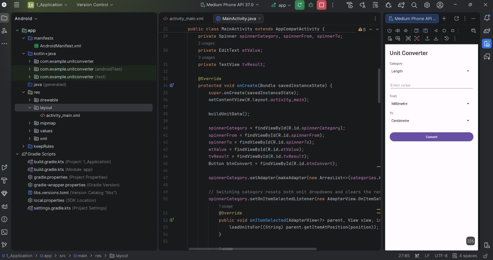

# Unit Converter (Android)

An Android app that converts values between common units of measurement. Built with Java and XML in Android Studio.

## Features

- Numeric input field for the value to convert
- Category selector: **Length, Weight, Volume, Temperature**
- "From" and "To" unit dropdowns (Spinners) that reset when the category changes
- Convert button that shows the result with unit labels, e.g. `5 Kilometre = 3.1068559 Mile`
- Input validation: a Toast appears if the field is empty or not a valid number

## Supported Units

| Category    | Units |
|-------------|-------|
| Length      | Millimetre, Centimetre, Metre, Kilometre, Inch, Foot, Yard, Mile |
| Weight      | Milligram, Gram, Kilogram, Tonne, Ounce, Pound |
| Volume      | Millilitre, Litre, US Fluid Ounce, US Cup, US Gallon |
| Temperature | Celsius, Fahrenheit, Kelvin |

## How It Works

- Length, Weight and Volume: each unit stores a factor to a base unit (metre, kilogram, litre). Conversion is `value * fromFactor / toFactor`.
- Temperature: the value is converted to Celsius first, then to the target unit.
- Results are rounded to 8 significant digits with trailing zeros removed.

## Project Structure

```
app/src/main/java/com/example/unitconverter/MainActivity.java
app/src/main/res/layout/activity_main.xml
```

## Setup

1. Clone the repository.
2. Open it in Android Studio (File > Open).
3. Let Gradle sync, then run on an emulator or a physical device.

## Tech Stack

- Language: Java
- UI: XML layouts
- IDE: Android Studio

## Screenshots




## Author

Kakulavaram Ruthika